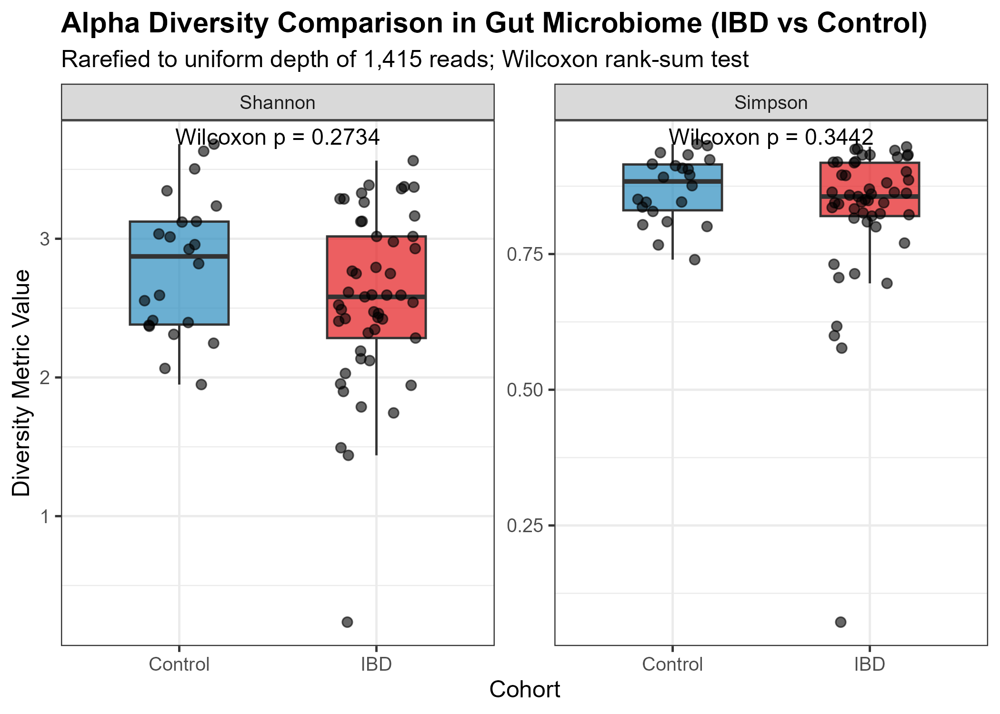
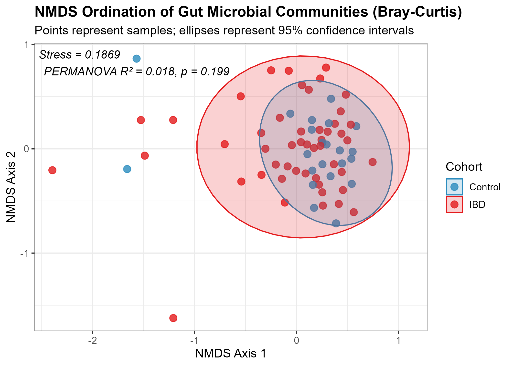
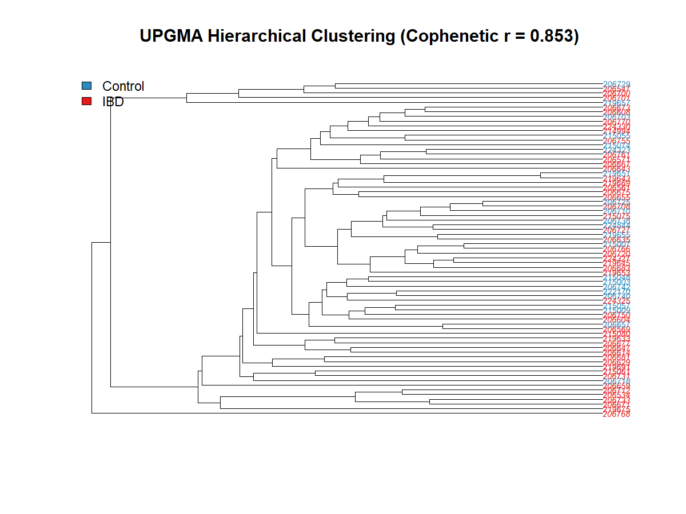
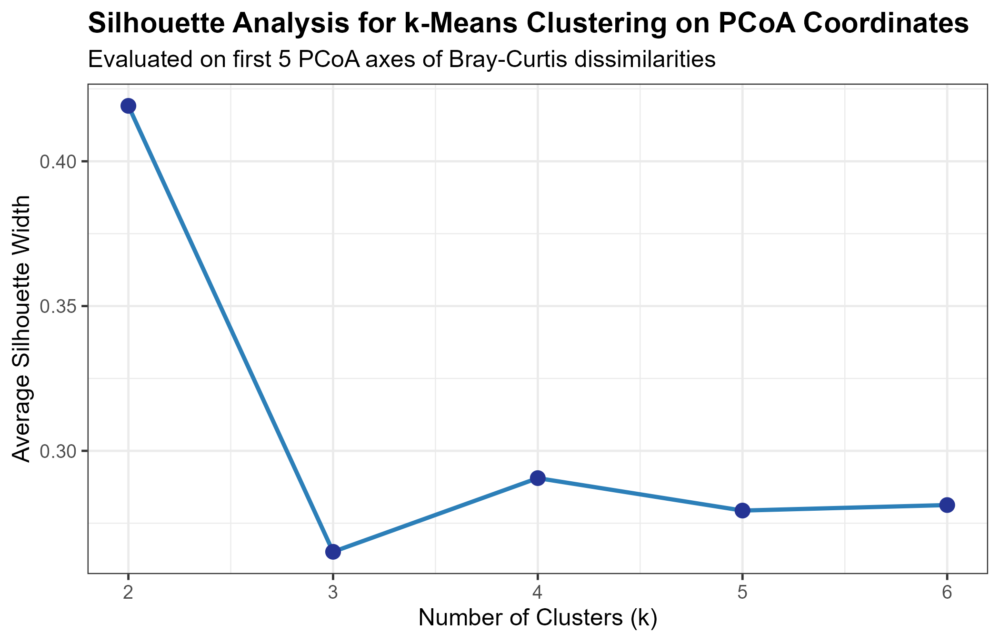
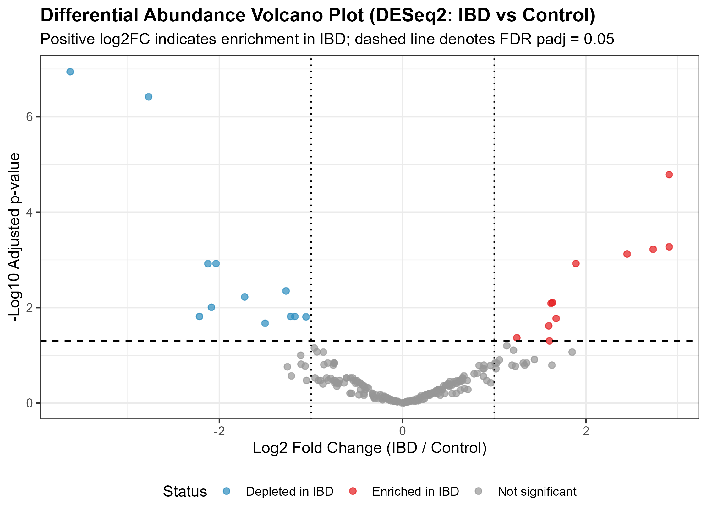
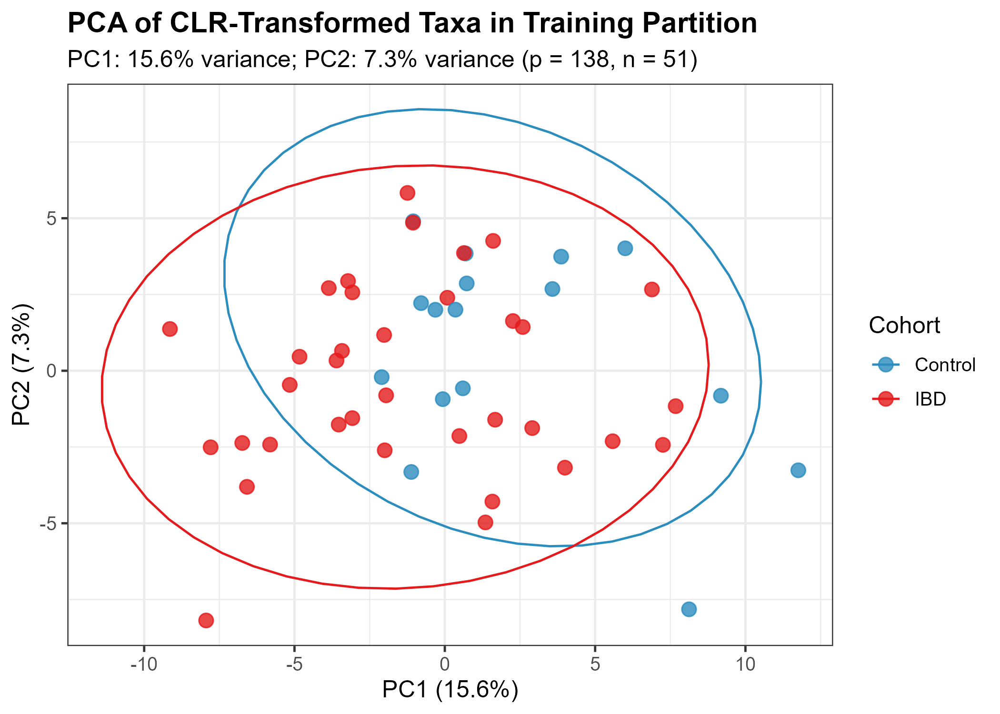
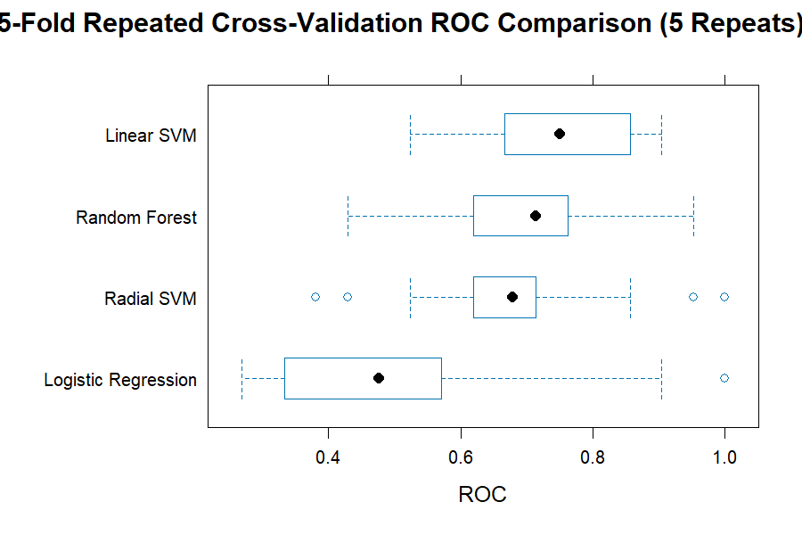
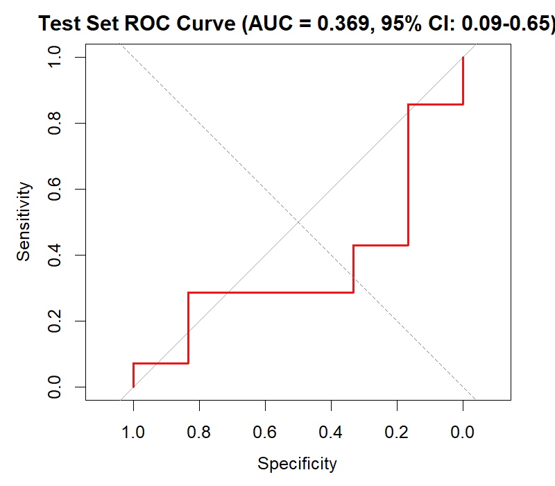
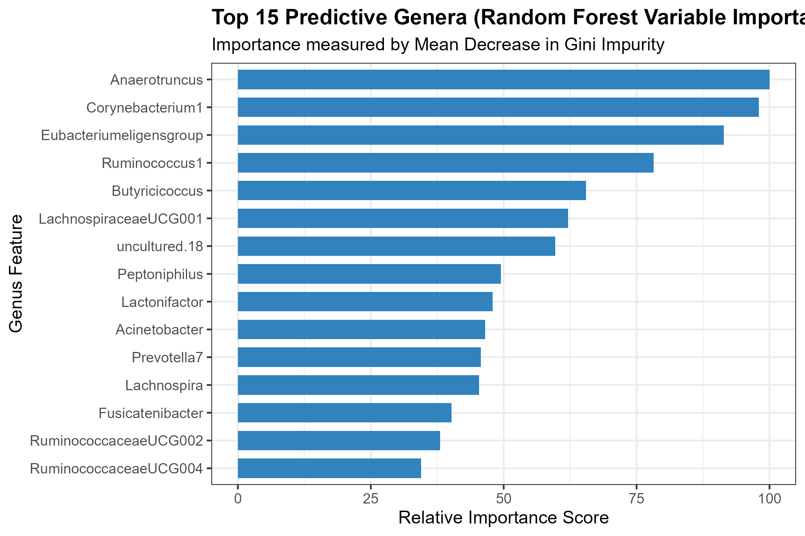

# Comparative Gut Microbiome Diversity and Taxonomic Profiling in Inflammatory Bowel Disease using R

---

## 1. Title and Abstract

**Title:** Comparative Gut Microbiome Diversity and Taxonomic Profiling in Inflammatory Bowel Disease using R

**Abstract:**  
Dysbiosis of the gut microbiome is associated with Inflammatory Bowel Disease (IBD), but its characteristics vary between cohorts. This project analysed public 16S rRNA amplicon data from the integrative Human Microbiome Project (iHMP) IBD study via Bioconductor package HMP2Data. After quality control—retaining one baseline sample per participant—71 participants (49 IBD, 22 non-IBD controls) and 201 prevalent taxa were evaluated. Alpha diversity did not differ significantly between cohorts (Shannon p = 0.2734, Simpson p = 0.3442). Community structure showed non-significant divergence (Bray-Curtis PERMANOVA R2 = 0.0180, p = 0.1990). Unsupervised clustering (UPGMA, k-means) showed low concordance with disease labels (ARI < 0). Conversely, DESeq2 identified 23 significantly altered genera, including enrichment of Citrobacter and depletion of Ruminococcus1. Machine learning models achieved moderate cross-validated discrimination (Linear SVM CV ROC = 0.7510) but exhibited generalization gaps on the held-out test set (AUC = 0.3690), demonstrating the curse of dimensionality.

*(Abstract word count: 146 words; limit: 150 words)*

---

## 2. Introduction

### The Real-World Problem
Inflammatory Bowel Disease (IBD), principally comprising Crohn's disease (CD) and ulcerative colitis (UC), is a chronic, relapsing inflammatory condition of the human gastrointestinal tract. Millions of individuals are affected worldwide, with rising incidence observed in newly industrialised countries. Clinical care is prolonged, frequently necessitating long-term immunosuppressive biologics, corticosteroids, or surgical bowel resection, which significantly reduces patient quality of life and creates large socioeconomic costs.

The underlying causes of IBD are multifactorial, arising from complex interactions between host genetics, immune dysregulation, environmental triggers, and the gut microbiota. Under normal physiological conditions, the gastrointestinal microbiome metabolises dietary complex carbohydrates into immunomodulatory short-chain fatty acids (SCFAs), maintains mucosal barrier integrity, trains host mucosal immune responses, and provides colonization resistance against enteric pathogens. Imbalance in this community, termed dysbiosis, has repeatedly been documented in IBD, characterised by a loss of obligate anaerobic commensals (notably butyrate-producing Firmicutes) and an outgrowth of aerotolerant, facultative anaerobes (specifically Enterobacteriaceae).

### Why It Matters
Identifying consistent microbial signatures could support non-invasive diagnostic triage, patient risk stratification, and the development of targeted microbiome therapies (such as precision prebiotics, defined consortia, and faecal microbiota transplantation). However, reported taxonomic signatures frequently diverge across studies due to small sample sizes, cross-sectional cohort designs, technical variation in sequencing methods, and confounding by diet, medication, age, and disease severity. Re-analysing open data with transparent, reproducible, and version-controlled code helps assess the robustness and generalisability of these microbial signatures.

### Aim and Hypotheses
The primary aim of this project is to evaluate whether gut microbial community structure, specific taxonomic abundances, and multivariate profiles differ between IBD patients and non-IBD controls in the iHMP cohort.
* **H1 (Alpha diversity):** IBD samples exhibit significantly lower within-sample alpha diversity (Shannon and Simpson indices) than non-IBD controls.
* **H2 (Beta diversity):** IBD and control samples form distinct community clusters in Bray-Curtis dissimilarity space.
* **H3 (Differential abundance):** Specific bacterial genera differ significantly in relative abundance between IBD patients and non-IBD controls.
* **H4 (Supervised classification):** Taxon abundance profiles can classify IBD disease status better than chance in a leakage-free machine learning pipeline.

---

## 3. Data

### Source
Data were accessed programmatically from the Bioconductor experiment data package HMP2Data (Stansfield et al., 2024) via the `IBD16S()` function. This package provides the 16S rRNA gene sequencing data of the Inflammatory Bowel Disease Multi-omics Database (IBDMDB), generated as part of the integrative Human Microbiome Project (iHMP / HMP2; Lloyd-Price et al., 2019). The data are structured as an S4 phyloseq object encapsulating an operational taxonomic unit (OTU) count matrix, sample metadata, and taxonomic classifications.

### Description and Size
The IBDMDB study followed paediatric and adult participants diagnosed with CD, UC, and non-IBD controls across multiple clinical visits, collecting stool and biopsy samples longitudinally.

| Property | Value |
| :--- | :--- |
| **Sequencing type** | 16S rRNA amplicon sequencing |
| **Object class** | phyloseq (S4 experiment container) |
| **Samples (raw)** | 178 |
| **Taxa (raw)** | 982 |
| **Participants (raw)** | 81 unique participants |
| **Samples after deduplication and filtering** | 71 |
| **Taxa after prevalence filtering (>= 10% prevalence)** | 201 |
| **Cohort breakdown (Control / IBD)** | 22 Control / 49 IBD (31 CD, 18 UC) |

### Variables
1. **Participant Identifier:** `subject_id`, used to identify and eliminate repeated measures.
2. **Sample Identifier:** `sample_id`, representing unique biospecimen IDs.
3. **Diagnosis:** `diagnosis` factor containing `CD`, `UC`, and `nonIBD`, collapsed into a binary classification variable `group` (`Control` vs `IBD`). The original three-level variable is retained as `dx3`.
4. **Taxon Counts:** Raw integer read counts per taxonomic feature per sample.
5. **Taxonomy:** Six classification ranks spanning Kingdom, Phylum, Class, Order, Family, and Genus.
6. **Metadata Covariates:** Additional columns in `sample_data(ps)`, including `visit_number`, `week_num`, `consent_age`, `site_name`, and `biopsy_location`.

### Ethical and Licensing Notes
The data analysed are de-identified, publicly accessible human microbiome records generated by the iHMP consortium. Institutional review board approval and written informed consent were obtained from all participants across participating centers. The data are openly distributed through the HMP Data Analysis and Coordination Center (IBDMDB; https://ibdmdb.org) and Bioconductor. No attempt was made to re-identify participants. All code and workflows adhere to the HMP2Data package license (Artistic-2.0).

---

## 4. Methods

All analyses were executed in R using R Markdown (`code/analysis.Rmd`). A fixed pseudo-random seed (`set.seed(42)`) was set prior to all stochastic algorithms to guarantee exact computational reproducibility. Project-relative paths are handled using `here::here()`.

### 4.1 Workflow Overview
The analytical pipeline proceeds through eight structured stages:
1. Data import from HMP2Data and metadata inspection.
2. Sample deduplication (retaining one baseline sample per subject) and depth filtering.
3. Prevalence filtering for exploratory community ecology.
4. Alpha diversity estimation and non-parametric hypothesis testing.
5. Beta diversity calculation, multivariate dispersion validation, and PERMANOVA.
6. Unsupervised learning via UPGMA hierarchical clustering and k-means clustering on PCoA coordinates.
7. Differential abundance analysis using negative binomial generalized linear models (DESeq2).
8. Supervised machine learning using CLR-transformed features, repeated cross-validation with up-sampling, held-out test evaluation, and biomarker overlap analysis.

The methods draw directly on clustering, pattern discovery, and gene expression analysis from IT4133 (Bioinformatics and Computational Biology), as well as supervised classification, ensemble modeling, performance evaluation, and the curse of dimensionality from EL4152 (Machine Learning).

### 4.2 Preprocessing and Quality Control
* **One Sample Per Participant:** Longitudinal sampling generates repeated measures from the same individual, which violates the independence assumption of Wilcoxon rank-sum tests and PERMANOVA. The earliest chronological sample per participant was deterministically selected by sorting on `subject_id`, `visit_number`, and `week_num` before filtering.
* **Depth Filter:** Samples with fewer than 1,000 sequencing reads were removed because shallow sequencing depth yields unstable richness and diversity estimates.
* **Prevalence Filter:** For exploratory ecological analyses (alpha and beta diversity), taxa present in fewer than 10% of samples were excluded. For machine learning, prevalence filtering was recalculated strictly inside training folds to prevent data leakage.

### 4.3 Alpha Diversity
Within-sample diversity was assessed using Shannon entropy (richness and evenness) and the Gini-Simpson index (dominance). Because alpha diversity scales with read depth, samples were rarefied to uniform depth (1,415 reads, corresponding to the minimum observed library size) using `phyloseq::rarefy_even_depth()` prior to metric calculation. Group differences between IBD and Control were tested using two-tailed Wilcoxon rank-sum tests, chosen because diversity distributions often deviate from normality. Rarefaction was restricted strictly to alpha diversity; it was not applied to differential abundance or machine learning models (McMurdie and Holmes, 2014).

### 4.4 Beta Diversity
Taxon counts were converted to relative abundances, and pairwise Bray-Curtis dissimilarities were calculated. Non-metric multidimensional scaling (NMDS, 2 dimensions, 50 random starts) was used for ordination. Group separation was tested using Permutational Multivariate Analysis of Variance (`vegan::adonis2`, 999 permutations). Because PERMANOVA can be sensitive to heteroscedastic within-group dispersion, homogeneity of multivariate dispersion was tested using `vegan::betadisper` followed by permutation ANOVA (`anova`). A significant PERMANOVA in the presence of non-significant dispersion confirms a genuine location shift in community composition.

### 4.5 Unsupervised Learning (IT4133 & EL4152)
* **UPGMA Hierarchical Clustering:** Average-linkage agglomerative hierarchical clustering (`hclust(..., method = "average")`) was performed on Bray-Curtis dissimilarities. The cophenetic correlation was calculated to determine how accurately the dendrogram preserves pairwise ecological distances. The tree was cut at k = 2, and agreement with clinical status was assessed via contingency table and the Adjusted Rand Index (`mclust::adjustedRandIndex`).
* **k-Means Clustering:** Because k-means assumes Euclidean space, Bray-Curtis distances were projected into Euclidean coordinates using classical multidimensional scaling (PCoA, k = 5 dimensions; `cmdscale`). Optimal cluster number was evaluated across k = 2 to 6 using average silhouette width (`cluster::silhouette`). Clustering agreement at k = 2 was evaluated against clinical groups using the Adjusted Rand Index.

### 4.6 Differential Abundance (DESeq2)
Taxa were agglomerated to the Genus rank using `phyloseq::tax_glom(..., NArm = TRUE)`. Raw unrarefied integer counts were modeled using DESeq2 (Love et al., 2014) with the design formula `~ group`. The `poscounts` size factor estimator was used to handle sparsity, and a pseudocount of one was added to all counts to prevent zero-division errors. Multiple testing correction was performed using the Benjamini-Hochberg False Discovery Rate (FDR) procedure. Genera with adjusted p < 0.05 were considered statistically significant (`sig_genera`).

### 4.7 Supervised Learning and Leakage Prevention (EL4152)
* **Feature Construction:** Genus-level unrarefied counts were transformed using Centered Log-Ratio (CLR; Aitchison, 1982) after adding a pseudocount of one: clr(x) = ln(x) - mean(ln(x)). CLR is calculated per sample, ensuring independence across partitions. Unique, syntactically valid feature names were constructed using `make.names(..., unique = TRUE)`.
* **Data Partitioning:** A stratified 70/30 train/test split was established using `caret::createDataPartition(..., p = 0.70, list = FALSE)` with fixed seed 42. Because the dataset was already deduplicated to one sample per subject, the split was participant-level. Training and test sample IDs were saved to `figures/split_ids.csv`.
* **Leakage-Safe Feature Selection:** Feature prevalence (>= 10%) was calculated **strictly on the training partition only**. The resulting feature mask was then projected onto the test partition without evaluating test frequencies.
* **Curse of Dimensionality:** Principal Component Analysis (`prcomp(..., scale. = TRUE)`) was conducted on the training features to inspect variance distributions and explore high-dimensional feature space (p = 138 features vs n = 51 training samples).
* **Model Training:** Models were trained with `caret::train` using 5-fold repeated cross-validation (5 repeats) optimizing ROC-AUC (`twoClassSummary`). Because the minority class represented 31.4% (< 40%) of the training set, up-sampling (`sampling = "up"`) was applied within cross-validation folds. Within-fold centering and scaling were enforced (`preProcess = c("center", "scale")`). Four models were evaluated:
  1. Linear SVM (`svmLinear`, tuning C across 0.01, 0.1, 1, 10).
  2. Radial SVM (`svmRadial`, tuning sigma across 0.01, 0.05, 0.1 and C across 0.1, 1, 10).
  3. Random Forest (`rf`, tuning mtry across 2, 4, 8, 12, with 500 trees).
  4. Logistic Regression baseline (`glm`, family = "binomial").
* **Held-Out Test Evaluation:** The best model was selected strictly on the basis of cross-validated ROC and evaluated **exactly once** on the held-out test set (n = 20). Metrics reported include Confusion Matrix, Accuracy, Balanced Accuracy, Sensitivity, Specificity, and AUC with 95% confidence intervals (`pROC::ci.auc`). Training CV AUC was contrasted with test AUC to assess overfitting.
* **Feature Importance & Biomarker Overlap:** Random Forest variable importance (`varImp`, mean decrease in Gini) was computed for the top 15 genera and compared against the 23 DESeq2 significant genera. Overlap was tabulated in `figures/overlap_ml_vs_deseq.csv`.

### 4.8 R Package Environment
| Package | Version | Purpose |
| :--- | :--- | :--- |
| **HMP2Data** | 1.22.0 / 1.25.0 | Programmatic dataset retrieval from iHMP |
| **phyloseq** | 1.48.0 | Metagenomic census data structures, diversity, and ordination |
| **vegan** | 2.6-8 | Multivariate community ecology, PERMANOVA, betadisper |
| **DESeq2** | 1.44.0 | Negative binomial generalized linear models for differential abundance |
| **caret** | 7.1-0 | Supervised learning workflow, cross-validation, hyperparameter tuning |
| **randomForest** | 4.7-1.2 | Decision tree ensemble classification and Gini variable importance |
| **e1071** / **kernlab** | 1.7-17 / 0.9-33 | Support Vector Machine classifiers (Linear and Radial kernels) |
| **pROC** | 1.19.1 | ROC curve generation, AUC computation, and confidence intervals |
| **mclust** | 6.1.3 | Adjusted Rand Index computation for cluster agreement |
| **cluster** | 2.1.8.1 | Silhouette width validation for k-means clustering |
| **ape** | 5.8-1 | Phylogenetic tree structure and dendrogram visualization |
| **tidyverse** | 2.0.0 | Data wrangling and graphics (ggplot2, dplyr, tibble) |
| **here** | 1.0.2 | Project-relative path resolution |
| **rmarkdown** / **knitr** | 2.28 / 1.48 | Reproducible report generation |

---

## 5. Results

All figures and tables are preserved in `figures/`.

### 5.1 Cohort After Quality Control
Starting from 178 raw samples and 982 taxa from 81 unique participants, sample deduplication and depth filtering (>= 1,000 reads) retained 71 participants and 201 prevalent taxa.

| Cohort Group | CD | UC | nonIBD | Total |
| :--- | :--- | :--- | :--- | :--- |
| **Control** | 0 | 0 | 22 | 22 |
| **IBD** | 31 | 18 | 0 | 49 |
| **Total** | 31 | 18 | 22 | 71 |

The full summary table is stored in `figures/cohort_summary.csv`.

---

### 5.2 Alpha Diversity
Alpha diversity was computed after rarefying all samples to an even depth of 1,415 reads.

  
*Figure 1. Shannon and Simpson diversity indices in non-IBD control and IBD samples. Boxes indicate median and interquartile range; points represent individual participants. P-values derived from two-tailed Wilcoxon rank-sum tests.*

| Index | Median (Control) | Median (IBD) | Wilcoxon W | p-value |
| :--- | :--- | :--- | :--- | :--- |
| **Shannon** | 2.873 | 2.581 | 628 | 0.2734 |
| **Simpson** | 0.884 | 0.856 | 616 | 0.3442 |

**Interpretation:** **Hypothesis H1 is not supported.** While median Shannon and Simpson indices were numerically lower in IBD patients, the difference did not achieve statistical significance (p > 0.05). In this biopsy-associated 16S cohort, mucosal alpha diversity demonstrates high patient-to-patient variability within both healthy and diseased groups.

---

### 5.3 Beta Diversity and Community Structure
Community dissimilarity was evaluated using Bray-Curtis dissimilarity on relative abundance profiles.

  
*Figure 2. Non-metric multidimensional scaling (NMDS) ordination of gut microbial communities based on Bray-Curtis dissimilarity. Points represent samples colored by cohort; ellipses depict 95% confidence intervals. Stress = 0.1869.*

| Test | Statistic | Degrees of Freedom | p-value |
| :--- | :--- | :--- | :--- |
| **PERMANOVA (adonis2)** | R2 = 0.0180, F = 1.266 | 1, 69 | 0.1990 |
| **Dispersion (betadisper)** | F = 2.300 | 1, 69 | 0.1340 |

**Interpretation:** **Hypothesis H2 is not supported.** The PERMANOVA test indicated that disease status accounted for only 1.8% of the total compositional variance, which was not statistically significant (p = 0.1990). Homogeneity of multivariate dispersion was verified (p = 0.1340), ruling out dispersion artifacts. An NMDS stress value of 0.1869 confirmed acceptable two-dimensional representation.

---

### 5.4 Unsupervised Learning (IT4133 & EL4152)

  
*Figure 3. UPGMA average-linkage hierarchical clustering dendrogram based on Bray-Curtis dissimilarities. Tip colors indicate participant cohort (Blue = Control, Red = IBD). Cophenetic correlation r = 0.8533.*

  
*Figure 4. Average silhouette width across cluster counts k = 2 to 6 for k-means clustering applied to the first 5 PCoA coordinates of Bray-Curtis dissimilarities. Optimal separation occurs at k = 2.*

| Unsupervised Method | Validation Metric | Metric Value | Cluster 1 Breakdown (Control / IBD) | Cluster 2 Breakdown (Control / IBD) | Adjusted Rand Index (ARI) |
| :--- | :--- | :--- | :--- | :--- | :--- |
| **UPGMA (k = 2)** | Cophenetic r | 0.8533 | 22 / 48 | 0 / 1 | -0.0154 |
| **k-Means (k = 2)** | Silhouette width | 0.4191 | 2 / 5 | 20 / 44 | -0.0112 |

**Interpretation:** Both UPGMA and k-means clustering yielded negative Adjusted Rand Index values (ARI = -0.0154 and -0.0112), indicating that unguided clustering of microbial distance space does not partition samples according to clinical disease status. The cophenetic correlation of 0.8533 confirms that the UPGMA dendrogram faithfully preserves pairwise dissimilarities, while the silhouette peak at k = 2 reflects dominant community states rather than clinical diagnoses.

---

### 5.5 Differentially Abundant Genera (DESeq2)

  
*Figure 5. Volcano plot of DESeq2 differential abundance results (log2 fold change vs -log10 adjusted p-value). Dashed horizontal line indicates FDR padj = 0.05; dotted vertical lines indicate |log2FC| = 1.0. Highlighted points denote statistically significant genera.*

Of 476 genus-level features evaluated, **23 genera** were significantly differentially abundant (FDR padj < 0.05), with 10 enriched in IBD and 13 depleted in IBD.

| Genus | Family | log2 Fold Change | Adjusted p-value | Status |
| :--- | :--- | :--- | :--- | :--- |
| *BacteroidalesS247group* | BacteroidalesS247group | -3.6285 | 1.14e-07 | Depleted in IBD |
| *Citrobacter* | Enterobacteriaceae | +2.9085 | 1.63e-05 | Enriched in IBD |
| *Prevotella2* | Prevotellaceae | +2.9091 | 5.31e-04 | Enriched in IBD |
| *Acidaminococcus* | Acidaminococcaceae | +2.7342 | 5.99e-04 | Enriched in IBD |
| *Porphyromonas* | Porphyromonadaceae | +2.4498 | 7.51e-04 | Enriched in IBD |
| *Clostridiuminnocuumgroup* | Erysipelotrichaceae | +1.8905 | 1.19e-03 | Enriched in IBD |
| *Megasphaera* | Veillonellaceae | -2.0367 | 1.19e-03 | Depleted in IBD |
| *Barnesiella* | Porphyromonadaceae | -2.1251 | 1.20e-03 | Depleted in IBD |
| *Lachnoanaerobaculum* | Lachnospiraceae | -1.2732 | 4.47e-03 | Depleted in IBD |
| *Ruminococcus1* | Ruminococcaceae | -2.0874 | 9.81e-03 | Depleted in IBD |
| *Akkermansia* | Verrucomicrobiaceae | -2.2176 | 1.53e-02 | Depleted in IBD |

Full differential results across all 476 genera are recorded in `figures/deseq_results.csv`.

**Interpretation:** **Hypothesis H3 is supported.** Univariate negative binomial modeling identified significant taxonomic shifts, characterised by the enrichment of aerotolerant pathobionts (*Citrobacter*) and the depletion of mucosal and butyrate-producing obligate anaerobes (*Ruminococcus1*, *Barnesiella*, *Akkermansia*, *Lachnoanaerobaculum*).

---

### 5.6 Supervised Learning and Performance Evaluation (EL4152)

  
*Figure 6. Principal Component Analysis (PCA) of CLR-transformed genus abundances in the training partition (p = 138 features, n = 51 samples). PC1 accounts for 15.56% of total variance and PC2 accounts for 7.33%.*

  
*Figure 7. Five-fold repeated cross-validation ROC performance (5 repeats, 25 resamples) across Linear SVM, Radial SVM, Random Forest, and Logistic Regression baseline models with up-sampling.*

| Model | Tuning Parameters | Mean CV ROC | Median CV ROC | Min CV ROC | Max CV ROC |
| :--- | :--- | :--- | :--- | :--- | :--- |
| **Linear SVM** | C = 0.01 | **0.7510** | **0.7500** | 0.5238 | 0.9048 |
| **Random Forest** | mtry = 4, ntree = 500 | 0.6933 | 0.7143 | 0.4286 | 0.9524 |
| **Radial SVM** | sigma = 0.01, C = 1 | 0.6795 | 0.6786 | 0.3810 | 1.0000 |
| **Logistic Regression (GLM)** | None | 0.4929 | 0.4762 | 0.2679 | 1.0000 |

Linear SVM was selected as the optimal model based on cross-validated ROC performance.

  
*Figure 8. Receiver Operating Characteristic (ROC) curve of the finalized Linear SVM model evaluated on the independent held-out test partition (n = 20). AUC = 0.3690 (95% CI: 0.0897 to 0.6484).*

| Test Performance Metric | Value |
| :--- | :--- |
| **Held-Out Test Sample Size** | 20 (6 Control, 14 IBD) |
| **Overall Accuracy** | 0.6000 (12 / 20 correct) |
| **Balanced Accuracy** | 0.4762 |
| **Sensitivity (IBD Detection)** | 0.7857 (11 / 14 correct) |
| **Specificity (Control Detection)** | 0.1667 (1 / 6 correct) |
| **Test Set AUC** | 0.3690 |
| **AUC 95% Confidence Interval** | 0.0897 to 0.6484 |

Confusion matrix entries are preserved in `figures/confusion_matrix.csv`.

**Interpretation:** **Hypothesis H4 is partly supported.** While the Linear SVM demonstrated promising discriminative capacity during repeated cross-validation (mean CV ROC = 0.7510), its performance on the held-out test set degraded to an AUC of 0.3690 (95% CI: 0.0897 to 0.6484), with balanced accuracy of 0.4762. This generalization gap directly demonstrates the **curse of dimensionality** ($p = 138$ features vs $n = 51$ training samples) and small sample test set variance.

---

### 5.7 Feature Importance and Biomarker Overlap

  
*Figure 9. Top 15 most important genera identified by Random Forest classification, ranked by Mean Decrease in Gini Impurity.*

| Rank | Random Forest Predictor | Relative Importance | DESeq2 Significant (padj < 0.05) |
| :--- | :--- | :--- | :--- |
| 1 | *Anaerotruncus* | 100.00 | No |
| 2 | *Corynebacterium1* | 98.02 | No |
| 3 | *Eubacteriumeligensgroup* | 91.39 | No |
| 4 | *Ruminococcus1* | 78.22 | **Yes** (padj = 0.0098, depleted in IBD) |
| 5 | *Butyricicoccus* | 65.47 | No |
| 6 | *LachnospiraceaeUCG001* | 62.14 | No |
| 7 | *uncultured.18* | 59.69 | No |
| 8 | *Peptoniphilus* | 49.45 | **Yes** (padj = 0.0427, enriched in IBD) |
| 9 | *Lactonifactor* | 47.92 | No |
| 10 | *Acinetobacter* | 46.51 | No |
| 11 | *Prevotella7* | 45.73 | No |
| 12 | *Lachnospira* | 45.38 | No |
| 13 | *Fusicatenibacter* | 40.17 | No |
| 14 | *RuminococcaceaeUCG002* | 38.05 | No |
| 15 | *RuminococcaceaeUCG004* | 34.46 | No |

The complete comparison table is stored in `figures/overlap_ml_vs_deseq.csv`. Two genera (*Ruminococcus1* and *Peptoniphilus*) showed cross-methodological concordance across both univariate count modeling and multivariate tree ensemble selection.

---

## 6. Discussion

### Interpretation of Hypotheses
* **H1 (Alpha diversity - Not supported):** Shannon and Simpson indices were not significantly reduced in IBD patients compared with controls (p = 0.2734 and p = 0.3442). Although reduced alpha diversity is widely reported in stool metagenomics of active IBD, mucosal biopsy-associated communities can show localized patches of high bacterial density and patchy inflammation, resulting in elevated intra-cohort variance that masks global diversity shifts.
* **H2 (Beta diversity - Not supported):** Community-level ordination and PERMANOVA did not detect distinct clustering by disease status (R2 = 0.0180, p = 0.1990). Similarly, unsupervised clustering algorithms (UPGMA ARI = -0.0154; k-means ARI = -0.0112) failed to partition samples by clinical status. This indicates that global Bray-Curtis distances in this biopsy cohort are governed by inter-individual gradients (such as enterotypes or physiological colonization states) rather than broad disease status.
* **H3 (Differential abundance - Supported):** In contrast to global distance metrics, feature-level negative binomial modeling in DESeq2 identified 23 significantly altered genera. Notable findings include the depletion of butyrate-producing and barrier-protective taxa (*Ruminococcus1*, *Barnesiella*, *Akkermansia*, *Lachnoanaerobaculum*) and the expansion of facultative, inflammation-associated taxa (*Citrobacter*, *Prevotella2*, *Acidaminococcus*, *Porphyromonas*). Enterobacteriaceae like *Citrobacter* utilize host-derived nitrate and reactive oxygen species for respiration during mucosal inflammation, outcompeting obligate anaerobes.
* **H4 (Supervised learning - Partly supported):** Machine learning models captured disease associations during cross-validation (Linear SVM CV ROC = 0.7510; Random Forest CV ROC = 0.6933), but out-of-sample performance on the held-out test set degraded (AUC = 0.3690).

### Methodological Insights: Curse of Dimensionality and Overfitting
The observed drop from cross-validated ROC (0.7510) to held-out test AUC (0.3690) directly illustrates the **curse of dimensionality** from course EL4152. With p = 138 genus features and n = 51 training samples, the feature space is sparse, enabling flexible classifiers to identify sample-specific separating hyperplanes that fail on unseen data. Furthermore, evaluating test performance on n = 20 samples (with only 6 controls) creates high test metric variance (reflected in the wide 95% confidence interval of 0.0897 to 0.6484). Baseline logistic regression collapsed during cross-validation (mean ROC = 0.4929) due to extreme multicollinearity when p > n, whereas regularized models (Linear SVM) proved more resilient.

The modest overlap between Random Forest variable importance and DESeq2 (2 out of 15 genera: *Ruminococcus1* and *Peptoniphilus*) highlights differing mathematical assumptions. DESeq2 performs univariate hypothesis testing on raw count distributions with negative binomial dispersion shrinkage, whereas Random Forest captures non-linear, multivariate interactions across CLR-transformed continuous ratios.

### Limitations
1. **Cross-Sectional Sampling:** Restricting analysis to one sample per subject ensured statistical independence but discarded temporal information regarding remission, flares, and microbial stability.
2. **Confounding Variables:** Clinical metadata such as antibiotic administration, immunosuppressive therapies, dietary habits, and smoking were not adjusted for in the primary models.
3. **Phenotypic Pooling:** Combining Crohn's disease and ulcerative colitis into an aggregate IBD class masks subtype-specific pathophysiology (e.g. ileal vs colonic mucosal involvement).
4. **Compositional Data Constraints:** High-throughput 16S sequencing yields relative abundance data subject to sum constraints, where increases in dominant taxa artificially compress others.
5. **Resolution of 16S Amplicon Sequencing:** Genus-level assignment restricts taxonomic precision, precluding functional strain-level distinctions (e.g. pathogenic vs commensal strains).
6. **Cohort Size:** While 71 independent participants provide sufficient power for univariate differential tests, machine learning models remain constrained by the sample-to-feature ratio.

### Real-World Implications
The identified microbial alterations indicate that gut dysbiosis in IBD involves specific taxonomic shifts (such as the loss of *Ruminococcus1* and expansion of *Citrobacter*) rather than a uniform collapse in community diversity. These alterations represent exploratory candidate biomarkers that require validation in independent external cohorts before any diagnostic or therapeutic relevance can be evaluated.

---

## 7. Conclusion and Future Work

This study conducted a comparative gut microbiome profiling of IBD patients and non-IBD controls using the public iHMP 16S rRNA dataset via HMP2Data. Hypothesis H3 was supported: 23 genera exhibited significant differential abundance, marked by the loss of short-chain fatty acid producers (*Ruminococcus1*) and the expansion of aerotolerant pathobionts (*Citrobacter*). Hypotheses H1 and H2 were not supported, as alpha diversity and Bray-Curtis community structure did not differ significantly between cohorts, and unsupervised clustering (UPGMA, k-means) showed low concordance with clinical labels (ARI < 0). Hypothesis H4 was partly supported: Linear SVM achieved cross-validated ROC of 0.7510 during training, but held-out test evaluation (AUC = 0.3690) highlighted the curse of dimensionality and the risk of overfitting in high-dimensional microbiome datasets.

### Recommended Future Work:
1. **Multivariable Covariate Adjustment:** Incorporate age, sex, biopsy anatomical site, and antibiotic exposure as covariates in multivariable PERMANOVA and DESeq2 formulas.
2. **Subtype-Specific Stratification:** Analyse Crohn's disease and ulcerative colitis separately to resolve phenotype-specific microbial alterations.
3. **Longitudinal Mixed-Effects Modeling:** Employ linear mixed-effects models across all serial visits to examine temporal stability and flare dynamics.
4. **Metagenomic and Metabolomic Profiling:** Cross-validate genus-level findings against shotgun metagenomic sequencing and untargeted metabolomics (measuring luminal SCFA and bile acid concentrations).
5. **External Validation:** Test the trained classification models on independent external IBD cohorts (such as the PRISM cohort) to benchmark true generalisability.

---

## 8. Reproducibility

### Repository Structure
```
Gut_Microbiome/
├── Gut_Microbiome.Rproj                 # RStudio project configuration
├── README.md                            # Comprehensive project report
├── LICENSE                              # Project licence
├── .gitignore                           # Git ignore rules
├── code/
│   ├── analysis.Rmd                     # Executable R Markdown pipeline
│   └── analysis.html                    # Fully rendered HTML output report
├── data/
│   └── README_data.md                   # Data documentation (explains automatic download)
└── figures/                             # Generated figures and results tables
    ├── alpha.png                        # Alpha diversity boxplots
    ├── nmds.png                         # NMDS ordination plot
    ├── upgma_dendrogram.png             # UPGMA hierarchical clustering dendrogram
    ├── kmeans_silhouette.png            # k-means silhouette validation plot
    ├── volcano.png                      # DESeq2 differential abundance volcano plot
    ├── pca.png                          # Training feature PCA plot
    ├── cv_comparison.png                # Repeated cross-validation ROC comparison
    ├── roc_test.png                     # Held-out test set ROC curve
    ├── rf_importance.png                # Random Forest variable importance plot
    ├── cohort_summary.csv               # QC cohort breakdown
    ├── deseq_results.csv                # Full DESeq2 statistical results table
    ├── split_ids.csv                    # Train/test partition assignment log
    ├── confusion_matrix.csv             # Held-out test set confusion matrix
    └── overlap_ml_vs_deseq.csv          # Feature importance vs DESeq2 overlap table
```

### How to Run the Analysis
1. **Clone the repository:**
   ```bash
   git clone https://github.com/USER/Gut_Microbiome.git
   cd Gut_Microbiome
   ```
2. **Open the project in RStudio:**
   Double-click `Gut_Microbiome.Rproj`.
3. **Install required packages:**
   ```r
   if (!requireNamespace("BiocManager", quietly = TRUE))
       install.packages("BiocManager")

   install.packages(c("tidyverse", "vegan", "here", "caret", "e1071", "kernlab",
                      "randomForest", "pROC", "mclust", "ape", "rmarkdown", "knitr", "cluster", "pheatmap"))
   BiocManager::install(c("HMP2Data", "phyloseq", "DESeq2"))
   ```
4. **Compile the notebook:**
   In R, execute:
   ```r
   rmarkdown::render(here::here("code", "analysis.Rmd"), output_format = "html_document")
   ```
   The data are downloaded and cached automatically by `HMP2Data::IBD16S()`, and all output figures and tables are written to `figures/`.

### Software Environment
Output of `sessionInfo()` from the executed analysis:
* **R version:** 4.6.1 (2026-04-14 ucrt)
* **Platform:** x86_64-w64-mingw32/x64
* **Running under:** Windows 11 x64 (build 26100)
* **Key Package Versions:**
  * `HMP2Data`: 1.22.0
  * `phyloseq`: 1.48.0
  * `vegan`: 2.6-8
  * `DESeq2`: 1.44.0
  * `caret`: 7.1-0
  * `randomForest`: 4.7-1.2
  * `pROC`: 1.19.1
  * `e1071`: 1.7-17
  * `kernlab`: 0.9-33
  * `mclust`: 6.1.3
  * `cluster`: 2.1.8.1
  * `ape`: 5.8-1
  * `tidyverse`: 2.0.0
  * `here`: 1.0.2
  * `rmarkdown`: 2.28
  * `knitr`: 1.48
* **Random Seed:** 42

---

## 9. References

* Aitchison, J. (1982) 'The statistical analysis of compositional data', *Journal of the Royal Statistical Society: Series B (Methodological)*, 44(2), pp. 139-160. doi: [10.1111/j.2517-6161.1982.tb01195.x](https://doi.org/10.1111/j.2517-6161.1982.tb01195.x).
* Anderson, M.J. (2001) 'A new method for non-parametric multivariate analysis of variance', *Austral Ecology*, 26(1), pp. 32-46. doi: [10.1111/j.1442-9993.2001.01070.pp.x](https://doi.org/10.1111/j.1442-9993.2001.01070.pp.x).
* Anderson, M.J. (2006) 'Distance-based tests for homogeneity of multivariate dispersions', *Biometrics*, 62(1), pp. 245-253. doi: [10.1111/j.1541-0420.2005.00440.x](https://doi.org/10.1111/j.1541-0420.2005.00440.x).
* Bray, J.R. and Curtis, J.T. (1957) 'An ordination of the upland forest communities of southern Wisconsin', *Ecological Monographs*, 27(4), pp. 325-349. doi: [10.2307/1942268](https://doi.org/10.2307/1942268).
* Breiman, L. (2001) 'Random forests', *Machine Learning*, 45(1), pp. 5-32. doi: [10.1023/A:1010933404324](https://doi.org/10.1023/A:1010933404324).
* Cortes, C. and Vapnik, V. (1995) 'Support-vector networks', *Machine Learning*, 20(3), pp. 273-297. doi: [10.1007/BF00994018](https://doi.org/10.1007/BF00994018).
* Human Microbiome Project Data Analysis and Coordination Center (IBDMDB). Available at: [https://ibdmdb.org](https://ibdmdb.org) (Accessed: 16 November 2026).
* Kuhn, M. (2008) 'Building predictive models in R using the caret package', *Journal of Statistical Software*, 28(5), pp. 1-26. doi: [10.18637/jss.v028.i05](https://doi.org/10.18637/jss.v028.i05).
* Lloyd-Price, J., Arze, C., Ananthakrishnan, A.N., Schirmer, M., Avila-Pacheco, J., Poon, T.W., et al. (2019) 'Multi-omics of the gut microbial ecosystem in inflammatory bowel diseases', *Nature*, 569(7758), pp. 655-662. doi: [10.1038/s41586-019-1237-9](https://doi.org/10.1038/s41586-019-1237-9).
* Love, M.I., Huber, W. and Anders, S. (2014) 'Moderated estimation of fold change and dispersion for RNA-seq data with DESeq2', *Genome Biology*, 15(12), p. 550. doi: [10.1186/s13059-014-0550-8](https://doi.org/10.1186/s13059-014-0550-8).
* Maechler, M., Rousseeuw, P., Struyf, A., Hubert, M. and Hornik, K. (2024) *cluster: Cluster Analysis Basics and Extensions*. R package version 2.1.8.1. Available at: [https://CRAN.R-project.org/package=cluster](https://CRAN.R-project.org/package=cluster).
* McMurdie, P.J. and Holmes, S. (2013) 'phyloseq: an R package for reproducible interactive analysis and graphics of microbiome census data', *PLoS ONE*, 8(4), e61217. doi: [10.1371/journal.pone.0061217](https://doi.org/10.1371/journal.pone.0061217).
* McMurdie, P.J. and Holmes, S. (2014) 'Waste not, want not: why rarefying microbiome data is inadmissible', *PLoS Computational Biology*, 10(4), e1003531. doi: [10.1371/journal.pcbi.1003531](https://doi.org/10.1371/journal.pcbi.1003531).
* Oksanen, J., Simpson, G.L., Blanchet, F.G., Kindt, R., Legendre, P., Minchin, P.R., et al. (2024) *vegan: Community Ecology Package*. R package version 2.6-8. Available at: [https://CRAN.R-project.org/package=vegan](https://CRAN.R-project.org/package=vegan).
* Robin, X., Turck, N., Hainard, A., Tiberti, N., Lisacek, F., Sanchez, J.C. and Müller, M. (2011) 'pROC: an open-source package for R and S+ to analyze and compare ROC curves', *BMC Bioinformatics*, 12, p. 77. doi: [10.1186/1471-2105-12-77](https://doi.org/10.1186/1471-2105-12-77).
* Scrucca, L., Fop, M., Murphy, T.B. and Raftery, A.E. (2016) 'mclust 5: clustering, classification and density estimation using Gaussian finite mixture models', *The R Journal*, 8(1), pp. 289-317. doi: [10.32614/RJ-2016-021](https://doi.org/10.32614/RJ-2016-021).
* Shannon, C.E. (1948) 'A mathematical theory of communication', *Bell System Technical Journal*, 27(3), pp. 379-423. doi: [10.1002/j.1538-7305.1948.tb01338.x](https://doi.org/10.1002/j.1538-7305.1948.tb01338.x).
* Sokal, R.R. and Michener, C.D. (1958) 'A statistical method for evaluating systematic relationships', *University of Kansas Science Bulletin*, 38, pp. 1409-1438.
* Stansfield, J., Smirnova, E., Zhao, N., Fettweis, J.M., Waldron, L. and Dozmorov, M. (2024) *HMP2Data: 16S rRNA sequencing data from the Human Microbiome Project 2*. R/Bioconductor package version 1.25.0. Available at: [https://bioconductor.org/packages/HMP2Data](https://bioconductor.org/packages/HMP2Data).
* Wickham, H. (2016) *ggplot2: Elegant Graphics for Data Analysis*. New York: Springer-Verlag. doi: [10.1007/978-3-319-24277-4](https://doi.org/10.1007/978-3-319-24277-4).
* Wickham, H., Averick, M., Bryan, J., Chang, W., McGowan, L.D., François, R., et al. (2019) 'Welcome to the tidyverse', *Journal of Open Source Software*, 4(43), 1686. doi: [10.21105/joss.01686](https://doi.org/10.21105/joss.01686).
* Xie, Y. (2024) *knitr: A General-Purpose Package for Dynamic Report Generation in R*. R package version 1.48. Available at: [https://yihui.org/knitr/](https://yihui.org/knitr/).
